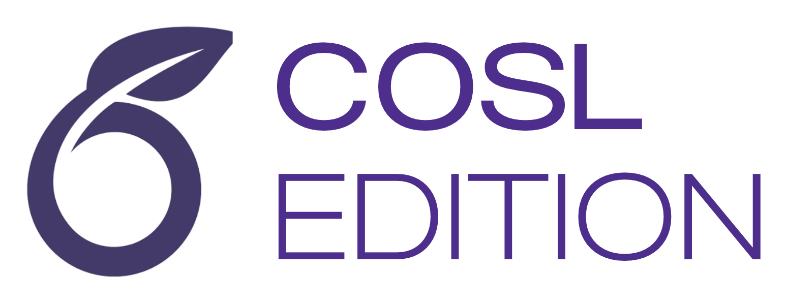
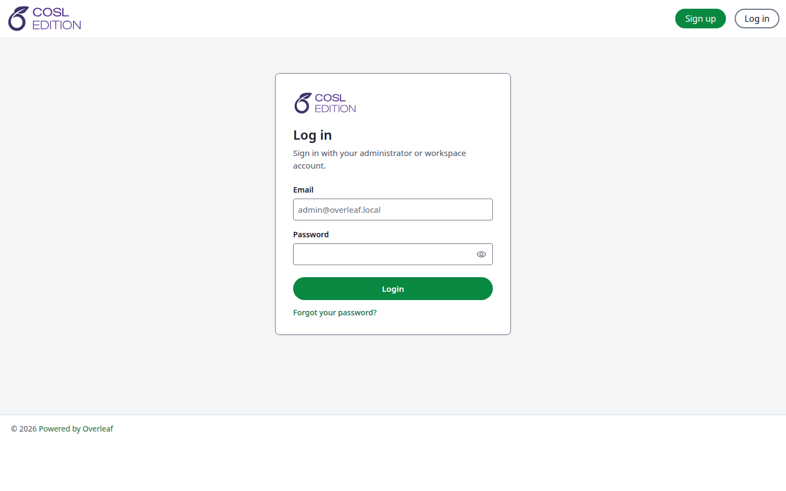
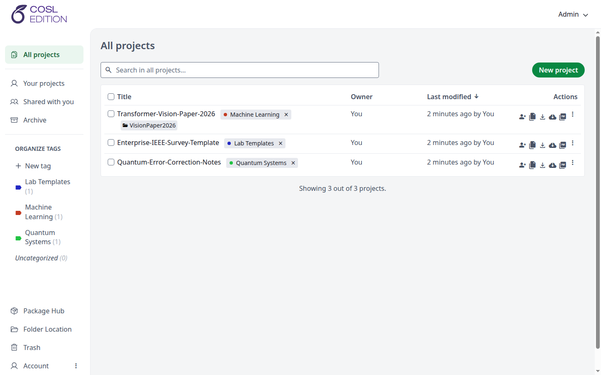
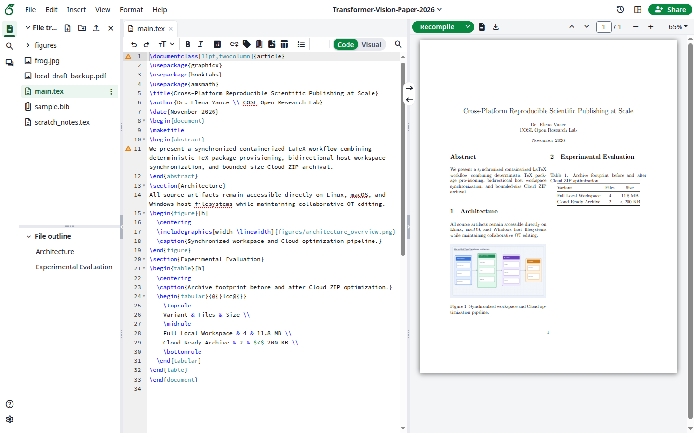
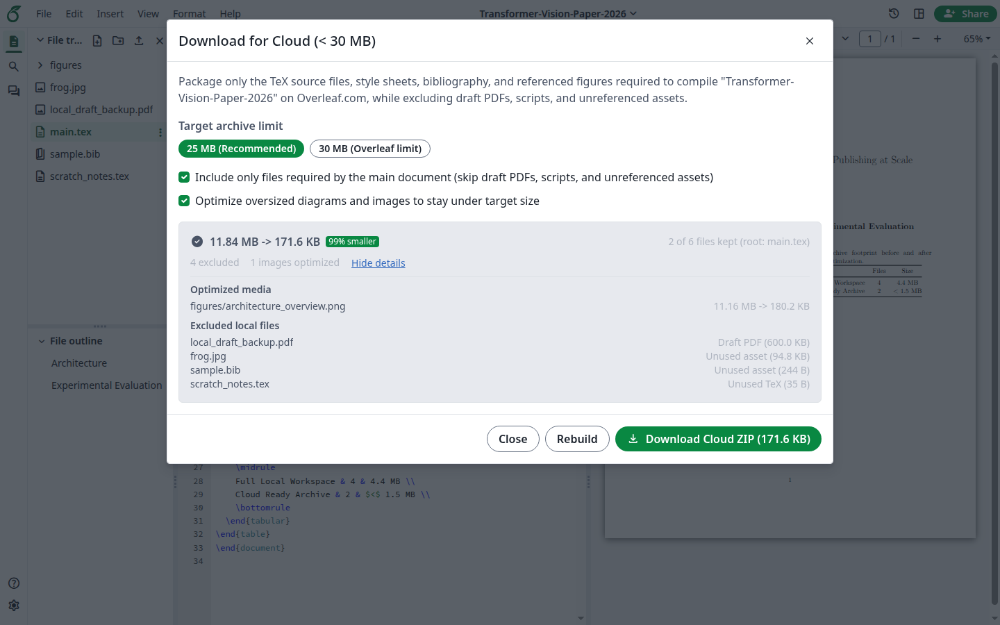
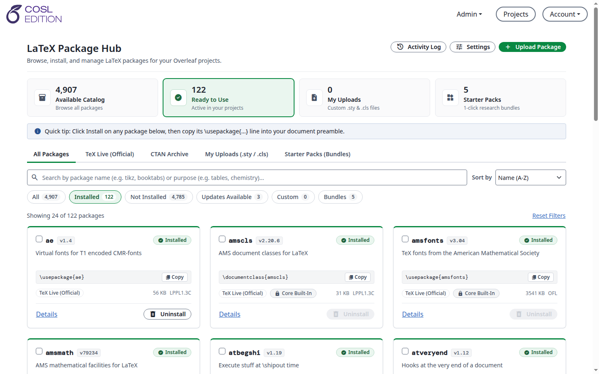
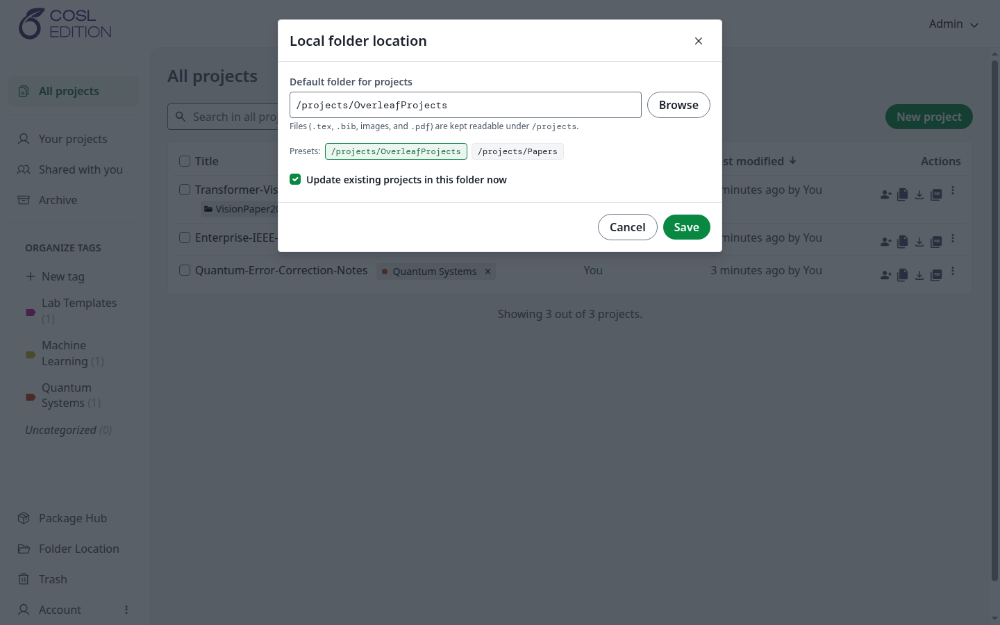
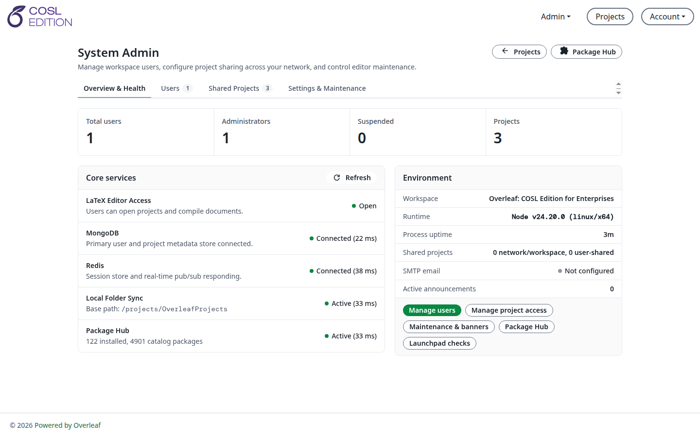
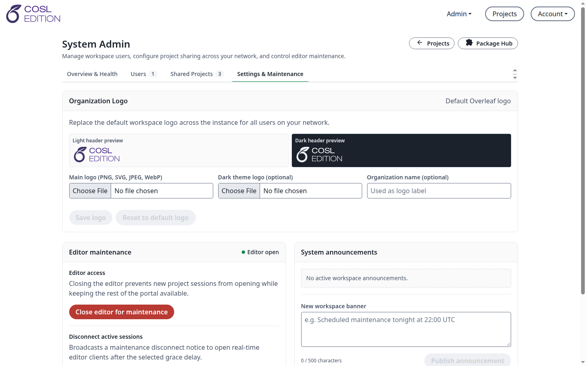
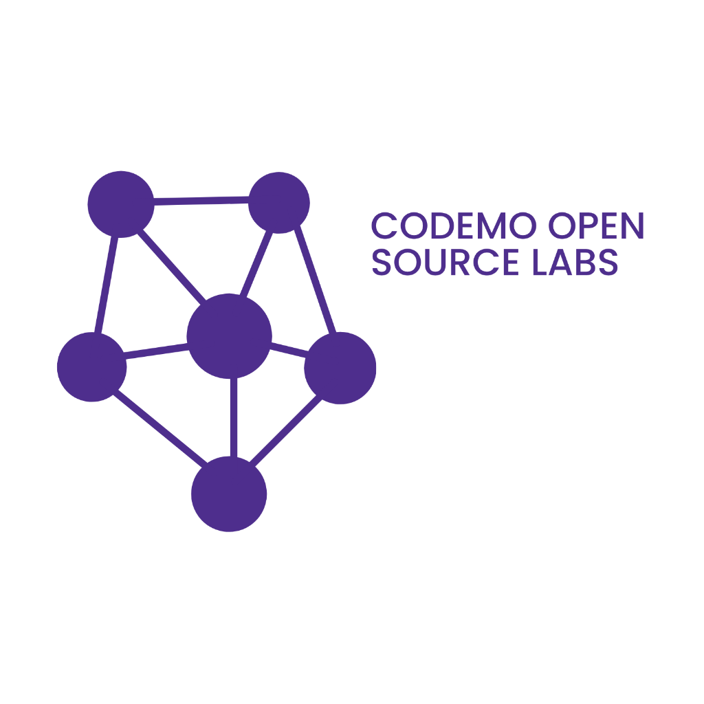

<div align="center">



# Overleaf: COSL Edition for Enterprises

**Local-First Speed. Collaborative Power. Cross-OS Control.**
A self-hosted enterprise distribution of Overleaf Community Edition forked from `overleaf/overleaf`, engineered for Linux, macOS, and Windows Docker hosts with bidirectional local folder sync, integrated TeX Package Hub, Cloud ZIP (`< 30 MB`) export, and instant hibernation.

<p align="center">
  <a href="docs/INSTALL.md"></a>
</p>

<table align="center">
  <tr>
    <td align="center" width="130">
      <br/>
      <b>Linux</b>
    </td>
    <td align="center" width="130">
      <br/>
      <b>Windows</b>
    </td>
    <td align="center" width="130">
      <br/>
      <b>macOS</b>
    </td>
  </tr>
</table>

</div>

## Overview

**Overleaf: COSL Edition for Enterprises** extends upstream Overleaf Community Edition into a complete, low-footprint research workspace designed to run comfortably inside a **1.50 GiB total RAM budget** across Linux, macOS, and Windows laptops, workstations, and lab servers.

- **Local Hosted LaTeX Package Hub (`/packages`)**: Built-in catalog and installer (`@overleaf/package-hub`) backed by TeX Live (`tlmgr`), live CTAN mirror fallback, multi-package Starter Packs, and custom `.sty`/`.cls` uploads stored on persistent volumes.
- **Fast Bidirectional Auto-Sync (`@overleaf/local-sync`)**: Three-way `.overleaf-sync.json` baseline reconciliation keeps your host folder and the browser OT editor synchronized automatically across VS Code, Vim, or any native IDE, paired with a tuned `15s` continuous OT flush (`MAX_UNFLUSHED_AGE_SECONDS=15`) so browser edits survive immediate page refreshes alongside external disk changes.
- **Per-Project Folder Allocation & Connected DB Workflows**: Map all projects to a default host directory or assign individual projects to custom host subfolders (`Folder Location` / `Set Local Folder...`) directly from the dashboard and row 3-dot menu without disconnecting MongoDB state or compile history.
- **Cloud ZIP (`< 30 MB`) Optimizer**: One-click `Download for Cloud (< 30 MB)` inside IDE **`File -> Download`**, IDE project title dropdown, `/project` row download toolbar, selection action bar, and 3-dot menu parses `.tex` inputs, prunes local draft PDFs/scripts/unreferenced files, and adaptively downscales oversized diagrams (`cloud_zip_optimize.py`) so heavy local repositories export ready for Overleaf.com.
- **Enterprise Admin Console, Network Sharing & Branding (`/admin`)**: Real-time system health telemetry, single-click user provisioning, policy-driven project access (`private`, `network` IP/CIDR allowlists, `all_users`, `custom`), **Organize Tags** in both the bulk toolbar and single-project 3-dot menu, and network-wide custom logo & title branding.
- **Cross-OS `ON` / `OFF` Hibernation CLI**: Cross-platform `overleaf-ctl` commands (`bash` for Linux/macOS, PowerShell + `.cmd` for Windows) gracefully flush live edits, capture SHA-256 verified `mongodump` archives before stopping containers to `0 MiB` RAM, and resume cleanly right where you left off.

## Application Showcase

<div align="center">


<p><sub>Sign-In experience featuring the clean vector COSL Edition logo and uncluttered navigation bar</sub></p>


<p><sub>Project Dashboard with the logo-only header, Organize Tags filters, and mapped host sync folder badges</sub></p>


<p><sub>Live IDE compiling synchronized host sources with Package Hub dependencies and automatic 15s OT persistence</sub></p>


<p><sub>Cloud ZIP (&lt; 30 MB) optimizer pruning draft PDFs and unused files while compressing figures for cloud upload</sub></p>


<p><sub>Integrated TeX Package Hub managing TeX Live, CTAN packages, Starter Packs, and custom style uploads</sub></p>


<p><sub>Host workspace folder browser and per-project destination allocator persisted to MongoDB</sub></p>


<p><sub>Enterprise Admin Console monitoring core services, Package Hub, Local Folder Sync, and user access</sub></p>


<p><sub>Network-wide Organization Logo controls with live Light/Dark header previews, maintenance toggles, and announcements</sub></p>

</div>

## Quick Installation

For full setup guides, firewall/LAN sharing options, and Overleaf Toolkit overrides, see **[docs/INSTALL.md](docs/INSTALL.md)**.

### Linux & macOS (Docker Compose Standalone)

```bash
git clone https://github.com/codemolabs/overleaf.git
cd overleaf
./scripts/install.sh
```

Custom options (custom port, LAN access, or custom host sync path):

```bash
./scripts/install.sh --port 8080 --projects-dir /home/user/OverleafProjects --listen 0.0.0.0
```

### Windows (PowerShell & Command Prompt on Docker Desktop / WSL2)

```powershell
git clone https://github.com/codemolabs/overleaf.git
cd overleaf
.\scripts\install.ps1
```

Or launch directly from `cmd.exe`:

```bat
scripts\install.cmd -ProjectsDir C:\Users\user\OverleafProjects -Port 80
```

### Pause & Resume Lifecycle (`OFF` / `ON` Commands)

Free all container RAM (`0 MiB`) without losing database state or host files:

**Linux & macOS:**

```bash
./scripts/overleaf-ctl.sh off          # Flush docs, dump verified MongoDB backup, stop containers
./scripts/overleaf-ctl.sh status       # Check container state & latest SHA-256 snapshot
./scripts/overleaf-ctl.sh on           # Resume seamlessly from saved DB & host state
./scripts/overleaf-ctl.sh on --restore # Restore from latest hibernate backup archive if needed
```

**Windows (PowerShell or `cmd.exe`):**

```powershell
.\scripts\overleaf-ctl.ps1 off
.\scripts\overleaf-ctl.ps1 status
.\scripts\overleaf-ctl.ps1 on
.\scripts\overleaf-ctl.ps1 on -Restore
```

```bat
scripts\overleaf-ctl.cmd off
scripts\overleaf-ctl.cmd on
```

> Using upstream **Overleaf Toolkit**? Replace `/home/user/overleaf-toolkit` paths directly via `scripts/overleaf-ctl.{sh,ps1}` copied into `bin/`, alongside `docker-compose.cross-os.example.yml`.

## Technical Architecture

| Layer | Component | Implementation |
| :--- | :--- | :--- |
| **Runtime & Memory Budget** | Phusion / Runit + Tuned Node/Mongo/Redis | 3-container stack capped under `1.50 GiB` total RAM (`1184 MiB` app, `288 MiB` WiredTiger MongoDB, `64 MiB` Redis) |
| **Web & Live OT Persistence** | Express + React + ShareDB (`@overleaf/web`) | `15s` `MAX_UNFLUSHED_AGE_SECONDS` continuous OT flush preventing live refresh data loss |
| **Package Install Hub** | `@overleaf/package-hub` (port `3020`) | OpenAPI 3.0 backend orchestrating `tlmgr`, CTAN fallbacks, Starter Packs, and persistent `texmf-local` overlays |
| **Bidirectional Folder Sync** | `@overleaf/local-sync` (port `3025`) | Chokidar + 3-way `.overleaf-sync.json` SHA-256 merge daemon bridging host filesystems across Linux/macOS/Windows |
| **Cloud ZIP Optimizer** | `ProjectCloudExportManager.mjs` + `cloud_zip_optimize.py` | Reachable TeX dependency graph pruning + Pillow/OptiPNG/QPDF multi-tier media compression under 25 MB / 30 MB limits |
| **Enterprise Governance** | `AdminService` + `ProjectAccessPolicyService` + `WorkspaceBrandingService` | CIDR/network & role sharing policies, user administration, Organize Tags workflows, and live organization branding |
| **Lifecycle & Backup CLI** | `scripts/overleaf-ctl.{sh,ps1,cmd}` | Cross-OS `OFF`/`ON` hibernation with Redis `BGSAVE`, gzip + SHA-256 verified `mongodump`/`mongorestore` |

## Documentation

| Document | Purpose |
| :--- | :--- |
| [**docs/INSTALL.md**](docs/INSTALL.md) | Complete installation instructions across Linux, macOS, Windows, and Overleaf Toolkit |
| [**docs/ENTERPRISE_FEATURES.md**](docs/ENTERPRISE_FEATURES.md) | Configuration, API endpoints, and usage guide for Package Hub, Cloud ZIP, Admin, and Branding |
| [**docs/LOCAL_FOLDER_SYNC.md**](docs/LOCAL_FOLDER_SYNC.md) | Bidirectional 3-way host folder sync mechanics, conflict handling, and cross-OS path rules |
| [**docs/COSL_MAINTENANCE.md**](docs/COSL_MAINTENANCE.md) | Backup automation, memory profiling, container tuning, and safe image upgrades |
| [**docs/COSL_CHANGELOG.md**](docs/COSL_CHANGELOG.md) | Detailed breakdown of COSL architectural enhancements over upstream Overleaf CE |

## Community & Governance

<div align="center">



<p>
  <a href="https://discord.gg/wD9d5Er7a"></a>
  &nbsp;&nbsp;&nbsp;&nbsp;
  <a href="https://github.com/codemolabs"></a>
  &nbsp;&nbsp;&nbsp;&nbsp;
  <a href="https://cosl.codemoteams.org"></a>
  &nbsp;&nbsp;&nbsp;&nbsp;
  <a href="mailto:cosl@codemoteams.org"></a>
</p>

</div>

<br>

**Overleaf: COSL Edition for Enterprises** is an official open-source distribution maintained by **[Codemo Open Source Labs (COSL)](https://github.com/codemolabs)** within the **[Codemo Teams](https://codemoteams.org)** ecosystem, built atop upstream Overleaf Community Edition (`overleaf/overleaf`).

- **Organization**: [Codemo Open Source Labs (@codemolabs)](https://github.com/codemolabs)
- **Repository**: [codemolabs/overleaf](https://github.com/codemolabs/overleaf)
- **Discord Community**: [Join Discord](https://discord.gg/wD9d5Er7a)
- **Contact / Inquiries**: `cosl@codemoteams.org`
- **License**: [GNU Affero General Public License v3.0 (AGPL-3.0)](LICENSE)
